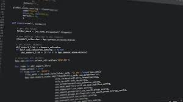

# Usman Ali Khan — Portfolio

Personal portfolio built with Next.js 13, Tailwind CSS, and Framer Motion, featuring smooth section transitions, custom cursor, and a light/dark theme toggle.



## Highlights

- Split layout: a printed card beside a portrait, then each project pinned beside a large picture
- A working copy of ReserveDesk's booking clash check, with sample bookings
- Archival photographs and NASA footage, all public domain or free of known restrictions, credited in the footer
- STIX Two Text throughout, in a tobacco, olive and ochre palette
- Content lives in `src/data/site.js`

## Tech Stack

- Next.js 13 (pages router)
- React 18
- Plain CSS in `src/styles/globals.css` (Tailwind base reset)

## Getting Started

```bash
npm install
npm run dev
```

Open [http://localhost:3000](http://localhost:3000).

## Build & Export

```bash
npm run build
```

This runs `next build` and `next export`, producing a static site in the `out/` directory.

## Deploy (GitHub Pages)

```bash
npm run deploy
```

This publishes the `out/` directory via `gh-pages`.
